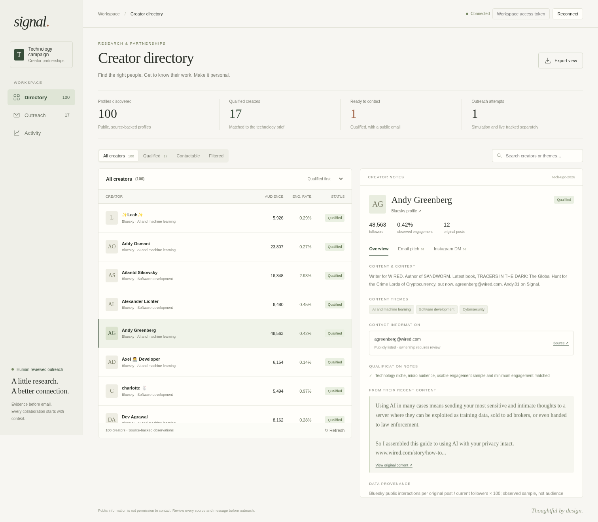
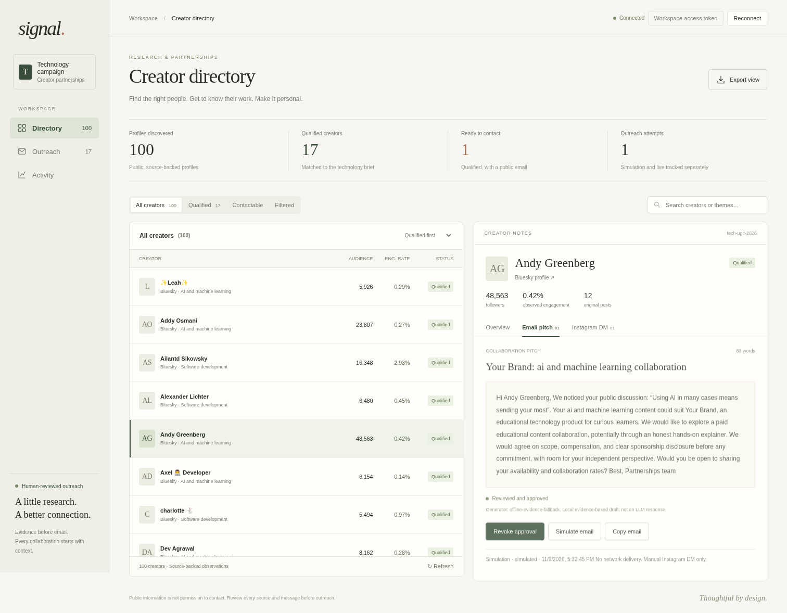

# Signal — Automated Micro-Influencer Outreach

A runnable, modular Python prototype for the EDXSO AI Engineer Intern assignment. Public discovery → evidence-based filtering → literal email enrichment → personalized email + Instagram-ready DM → human review → duplicate-safe simulation or TLS SMTP → CSV tracking.

**No API key is required for public Bluesky discovery or the included offline demonstration.** OpenAI-compatible AI generation, YouTube discovery, and actual SMTP sending require your own credentials.

> **Privacy:** all third-party email addresses in the bundled sample data are redacted (`redacted@example.com`). Rerun discovery to get real ones; use them only with consent and a lawful basis.

## Delivered test run

Real public observations collected on **9 November 2026 (UTC)**, not invented records:

| Result | Count |
|---|---:|
| Discovered profiles | 100 |
| Profiles in the 5,000–100,000 follower range | 100 |
| Passed the full Technology policy | 17 |
| Failed, with explicit reasons | 83 |
| Public email found, across all discovered profiles | 57 |
| Qualified profiles with a public email | 1 |
| Email pitches + Instagram-ready DM drafts | 17 pairs |
| Simulated email attempts | 1 |
| Real emails / automated DMs sent | 0 / 0 |

The local messages are explicitly labeled `offline-evidence-fallback`, **not LLM output**. The real LLM implementation is complete but has not been exercised with a paid API key. A public email occurrence is **not** proof of mailbox ownership, permission, or deliverability.

Artifacts:
- `data/export/influencers.csv`: every discovered profile, metrics, status, reasons, sources.
- `data/export/profiles.json`: richer observation evidence, post URLs, raw text, metric windows, email provenance.
- `data/export/messages.csv`: all qualified creators' email and DM drafts, generator and approval.
- `data/export/outreach_tracker.csv`: every discovered profile, message state, sending mode/status, date, Message-ID.
- `data/export/run_summary.json`, `events.json`: counts and audit trail.
- `data/simulation-first.json`, `simulation-second.json`: first simulation and duplicate prevention result.
- `data/test-results.txt`: test output. `docs/demo.md`: demonstration walkthrough.
- `docs/dashboard.png`: actual running-dashboard screenshot; `data/dashboard-smoke-results.txt`: HTTP/browser smoke results.
- `data/export/sample_messages.md`: human-readable version of all 17 email/DM pairs.

`data/test-run.log` is the initial discovery log; the final summary/JSON reflect the subsequently tightened filtering policy. Use the final exports as the submission dataset.

## UI preview — no setup required

Open **`dashboard-preview.html`** to inspect the redesigned workspace immediately. It embeds the real observation snapshot, styles and scripts, works offline, and requires no server or API credentials. Search, filters, sorting, Directory/Outreach/Activity views, message tabs and CSV export are available. Approval and sending are explicitly blocked in this read-only file; use the existing running dashboard for those operations.

The working UI is still served by the same `python -m outreach.cli serve` command; no new backend or framework was added. The interface uses warm ivory, forest green, olive and clay accents, system typography and serif headings, with no remote fonts, blue/purple palette or gradients.





Mobile view: `docs/dashboard-mobile.png`.

After deliberately changing the underlying dataset, optionally rebuild the offline preview with `python scripts/build_preview.py`. This is not needed to open the included file.

## Quick start

Requires Python 3.10+ and network access for fresh discovery. Commands assume the repository root.

```bash
python -m venv .venv
# macOS/Linux
source .venv/bin/activate
# Windows PowerShell: .venv\Scripts\Activate.ps1
python -m pip install -r requirements.txt
cp .env.example .env
# Windows PowerShell: Copy-Item .env.example .env
python -m outreach.cli init
```

### View the delivered real snapshot without rediscovering

The SQLite file is a local runtime convenience and intentionally ignored by Git. The exported JSON is the portable source of the delivered observations.

```bash
python scripts/restore_snapshot.py
python -m outreach.cli serve
# Open http://127.0.0.1:8000
```

The restore script upserts the delivered profiles and generates unapproved offline drafts. It does not restore demo approval/delivery state or send anything. Do not overwrite `data/export/profiles.json` with an empty export before restoring. Preserve an original copy of the dataset if experimenting.

### Run fresh public discovery

```bash
python -m outreach.cli run --provider bluesky --limit 100
# Or a custom query set; repeat --query for each term:
python -m outreach.cli discover --limit 60 --query developer --query cybersecurity
python -m outreach.cli generate --generator offline
python -m outreach.cli export
```

`run` discovers, filters, enriches, generates and exports; **it does not approve or send**. Upserts accumulate distinct platform IDs in the same database. Use a new `DATABASE_PATH` for an independent run. Search results and follower counts change; a requested limit is a ceiling, not a promise of that many relevant or contactable profiles. Shortfalls are printed explicitly. A stricter filter can legitimately produce few contactable creators.

### Generate real LLM personalization

Set `LLM_API_KEY`, `LLM_MODEL`, and optionally `LLM_BASE_URL` in `.env`.

```bash
python -m outreach.cli generate --generator llm --overwrite
python -m outreach.cli export
```

Generation validates JSON shape, email length (60–90 words), DM length (15–30 words), and subject safety. It retries up to three times. Failed records are logged and skipped, not silently replaced with pretend AI output. The full system prompt is in `outreach/personalization.py`. Existing messages are preserved unless `--overwrite` is supplied. Regeneration revokes approval. Transmitting public profile text to an LLM provider still needs a privacy review.

### Review and demonstrate sending

In the dashboard, inspect profile, email source, content source and draft; click **Approve reviewed messages**, then **Simulate email**. Or:

```bash
python -m outreach.cli approve --id 'ACTUAL_PROFILE_ID_FROM_PROFILES_JSON'
python -m outreach.cli send
python -m outreach.cli send  # duplicate_skipped; no second simulated attempt
python -m outreach.cli export
```

Do not literally use the descriptive ID above. IDs come from your actual dataset. Approval is deliberately per creator; there is no bulk blind-approval command.

**Live sending requires explicit opt-in**, real `BRAND_*`/`CAMPAIGN_OFFER` values, complete `SMTP_*` settings, `LIVE_SEND_ENABLED=yes`, and reviewed messages:

```bash
python -m outreach.cli send --live
```

Ports 587 (STARTTLS) and 465 (implicit TLS) only. `sent` means the SMTP server accepted the email, **not** delivery/open/read. Unknown outcomes are not retried automatically. Simulated and live modes have separate deduplication keys; simulation does not block a later intentional live attempt. A live attempt will not repeat for the same campaign/contact even if a process crashes. Inspect provider logs for any `sending`/`unknown` record before manual reconciliation. Never delete a delivery just to bypass deduplication.

```bash
python -m outreach.cli suppress --email 'redacted@example.com' --reason 'Opt-out'
```

Suppression blocks all future campaigns for that email. Monitor replies manually; there is no automatic reply ingestion. Instagram DMs are **manual drafts only**, even for creators discovered on another platform. Verify an actual Instagram handle and permission before using a draft.

### Optional YouTube source

Enable YouTube Data API v3 in Google Cloud and set `YOUTUBE_API_KEY`.

```bash
python -m outreach.cli run --provider youtube --limit 60 --query 'software tutorials'
```

Uses official `search.list`, `channels.list`, `playlistItems.list`, `videos.list`. Hidden subscribers and unavailable engagement statistics remain missing. Country, if returned, is labeled **creator country**, never audience geography. Query requests consume quota; the default daily quota may not support a large run.

### Optional website enrichment

```bash
python -m outreach.cli discover --provider bluesky --limit 60 --crawl-web
```

Off by default. Follows only explicit bio website URLs, checks public IP resolution and robots.txt, allows at most two same-origin HTML pages, and extracts literal emails. No login, CAPTCHA bypass, inferred email patterns, private IPs, redirect following or data-broker lookup. A missing/disallowed robots.txt is conservatively skipped. Bare domains in prose are not guessed into website URLs. Network-level egress controls are still necessary against DNS rebinding in production.

## Filtering and metrics

Complete category: **Technology**, with AI/ML, software development, tech education, cybersecurity and gadget themes.

Pass requires:
1. 5,000–100,000 observable followers/subscribers (inclusive).
2. Explicit technical bio evidence **or** at least 3 matching original posts covering ≥25% of the sampled content.
3. At least 3 usable original posts and observed public interaction rate ≥0.1%.
4. No recognized institution/organization name, mirrored bridge profile or excluded adult-content bio.
5. If `--geography` is requested, known matching **audience** geography. Public APIs here do not expose it, so unknowns fail that optional requirement.

These are transparent prototype heuristics, not claims of exhaustive brand safety. Names/phrases may be misclassified; manual review remains mandatory. Geography/age/gender are considered as unknown and never inferred from names, language or flags.

Bluesky ER = `100 × average(likes + replies + reposts per sampled original post) / current followers`.
YouTube ER = `100 × average(likes + comments per usable sampled video) / current subscribers`.

These are platform-specific **follower-based interaction proxies**, not verified reach, audience authenticity, view-based ER, or cross-platform comparable metrics. Bluesky excludes reposts, replies and pinned feed entries, samples up to 12 original posts from one recent feed response, and exports the observed date window. Hidden YouTube counters are not treated as zero. Search and default query seeds bias discovery toward searchable English-language tech profiles.

## Stack and project layout

Python standard library (`sqlite3`, `http.server`, `smtplib`, `ssl`, CSV/JSON), Requests for APIs, vanilla HTML/CSS/JS dashboard, pytest.

```text
outreach/          discovery, filtering, enrichment, AI, DB, sender, export, CLI, HTTP server
web/index.html    responsive review dashboard; no CDN dependencies
scripts/          restore the authentic exported observation snapshot
 tests/           synthetic-fixture unit/integration tests (not influencer data)
 data/export/     actual public observation exports and deliverables
 docs/demo.md     runnable demo sequence
 README.md        setup and usage
 architecture.md  design, implementation status, tradeoffs
 to-do.md         owner actions: accounts, credentials, review and submission
```

```bash
python -m pytest -q
# Optional container; explicitly configure a long token because it binds 0.0.0.0:
docker build -t signal-outreach .
docker run --rm -p 8000:8000 --env-file .env \
  -e DASHBOARD_TOKEN='use-a-new-random-token-of-at-least-24-characters' \
  -v "$PWD/data:/app/data" signal-outreach
```

For a hosted preview set `HOST=0.0.0.0` and a `DASHBOARD_TOKEN` ≥24 characters. Enter it in the dashboard's Connect field. API reads and mutations require the token; tokens are held in tab-scoped sessionStorage. Loopback-only use can omit it. Do not expose the standard-library HTTP server directly to the Internet: put it behind HTTPS and an authenticated reverse proxy. No external browser resources are required.

## Submission honesty and limitations

- Real 100-profile observations are included; 17 profiles pass, and only one of those has a literal public email in this snapshot. Missing emails are `Not Found`; no fabricated contact or engagement data.
- Real LLM generation, YouTube and live SMTP are implemented but require your accounts/keys; the delivered run used Bluesky + local fallback + simulation.
- All Instagram messages are drafts, **not sent**. Instagram ownership and handles are not inferred from Bluesky identities.
- Public emails in posts might refer to third parties. Verify the source/ownership before approving. The demo uses one source-bio email, simulated only.
- Offline fallback varies evidence, content signal and one of three structures; it is deliberately less fluent than an LLM. It is intended for the default paid educational campaign. Real campaign changes should use the LLM path and reviewed offer terms.
- No open/click tracking, bounce webhooks, SMTP delivery receipts, reply ingestion, or automated follow-ups. Logs track attempts and SMTP acceptance only.
- SQLite, bounded synchronous calls and cursor/batch fetching are suitable for a small prototype; large production teams need stronger hosting, egress, privacy and operational controls. See `architecture.md`.
- Public data can change. Preserve collection timestamps and sources; do not present this snapshot as current indefinitely. Treat contact data carefully; use a private repository unless publication is justified.

See **`to-do.md`** for every remaining non-coding owner action.
