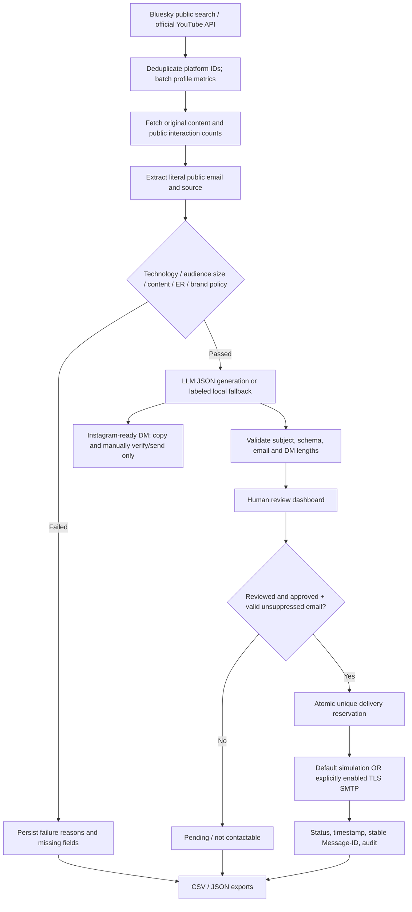

# Architecture and implementation status

## 1. Design objective

Provide an executable, evidence-first outreach pipeline, not a static list or a presentation. Every observed count and extracted email has a public source. Missing facts remain missing. Qualification, message generation, human review and sending are separate states so discovering an email never triggers an unsolicited message automatically.

**Chosen category:** Technology. **Executed provider:** Bluesky public AppView API (no authentication required for the endpoints used). **Additional implemented provider:** official YouTube Data API v3. Bluesky is a deliberate alternative social platform, not Instagram scraping. The assignment's suggested platforms are not an exclusive list. If the evaluator insists on YouTube, switch providers after supplying an API key.

## 2. End-to-end flow



No automatic DM endpoint exists. There is no browser automation or platform restriction bypass.

## 3. Modules and responsibilities

| Module | Responsibility |
|---|---|
| `config.py` | Repository `.env` loading, path and campaign/brand configuration |
| `http.py` | API client, connection/read timeouts, bounded retry/backoff, 429 handling, secret-safe errors |
| `discovery.py` | Provider normalization, source URLs, public profile metrics, bounded original-content collection |
| `enrichment.py` | Literal-email extraction and provenance, optional robots-aware website collection, conservative URL checks |
| `filtering.py` | Complete technology taxonomy and deterministic policy, failure explanations, unknown demographics |
| `personalization.py` | Untrusted-data LLM prompt, compatible API client, bounded repair attempts, validation, offline fallback |
| `db.py` | SQLite schema, atomic upserts, JSON evidence, timestamps, approval invalidation, audit events |
| `sending.py` | Per-profile review, opt-out suppression, TLS SMTP, simulation, atomic deduplication, uncertain outcome preservation |
| `exporting.py` | Portable influencer/message/tracker CSV, raw evidence JSON, summary and events, spreadsheet formula escaping |
| `cli.py` | Workflow orchestration and operational commands |
| `server.py` | Token-protected same-origin dashboard API; no live-send browser route |
| `web/index.html` | Searchable review interface, profile and content sources, message review and simulated sending |

## 4. Discovery design and provenance

### Bluesky

1. Search multiple technical topics and named public creator seeds with `app.bsky.actor.searchActors`.
2. Deduplicate by DID, which survives a handle change.
3. Batch `app.bsky.actor.getProfiles` (25 actors per request) for follower counts.
4. Rank the candidate pool by observable micro audience, explicit bio email, and technical-role evidence. This is **contactability-biased discovery**, not a representative sample of all creators.
5. Fetch `app.bsky.feed.getAuthorFeed` and retain up to 12 original non-reply posts, excluding repost/reason entries. One recent page is sampled rather than searching an unlimited history.
6. Save per-post text, URL, public interactions, publication date, and profile observation timestamp.

Default searches use up to 50 hits per query and one page per query for runs ≤100; larger runs use two pages. `--limit` controls the output ceiling, not the number of source hits. Sparse or exhausted searches can return fewer records; the CLI reports this. Use additional query sets/database runs if necessary. The 100 delivered profiles are authentic source results, not hand-entered identities or inferred metrics.

### YouTube

`search.list` finds channels; `channels.list` returns profile/subscriber data and uploads playlist; `playlistItems.list` and `videos.list` provide recent public videos and counters. Subscriber counts may be rounded. Hidden subscribers/likes/comments remain unavailable. Official API quota and provider access remain the owner's responsibility. Live access was not tested without a key.

## 5. Filtering and brand fit

A record passes when all required checks pass:

- Inclusive 5,000–100,000 current public audience count.
- Technology theme evidence using exact word-boundary matches.
- A relevant technical-role bio, or ≥3 relevant original posts and a ≥25% content relevance fraction.
- ≥3 usable content observations and ≥0.1% follower-based public interaction proxy.
- No recognized institutional name, mirrored account, or excluded adult-content bio.
- Optional requested audience geography must be positively known and match. Unknown does not pass that optional rule.

The keyword classifier does not infer audience age, gender, geography or sentiment. Simple negative AI-bio phrases are removed before niche classification, but negation/irony is not comprehensively understood. A person's location is never substituted for their audience's location. No claim of exhaustive creator identity verification, brand safety, audience authenticity or commercial suitability is made. Failure reasons and policy values are saved per profile; pass/fail is **not** based on whether an email is found.

**Metric formula:** `100 × mean(public interaction counts per usable item) / observed followers`. Bluesky includes likes, replies and reposts; YouTube includes available likes + comments. Do not compare those rates as if they were reach-normalized or platform-equivalent. Old content can accumulate interactions; the Bluesky sample window is exported to help review that bias. No comments/reposts/likes are invented when an API request fails.

## 6. Enrichment behavior

Each profile includes name, platform, URL, follower count, engagement measurement or null, category, themes, literal email or `Not Found`, and source fields. Age/gender/audience geography remain null. The CSV renders general missing values as `Not Available`; the requested missing-email sentinel remains exactly `Not Found`.

The email extractor reads public bio/content only, preserving each candidate's source. First observed candidate is selected, with bio evidence ahead of posts. It does not guess `firstname@domain`, decode obfuscated addresses, test mailboxes or purchase data. **An email in a post can belong to somebody else.** Human source verification is essential.

Website collection is opt-in, only for explicit HTTP(S) URLs in bios. It respects accessible robots.txt, stays on the same origin, restricts ports/protocols, disallows redirects and private IP resolutions, limits HTML size and page count, and never bypasses access controls. This is best-effort application SSRF mitigation; a production deployment must add network egress restrictions against DNS rebinding. Missing robots.txt is treated conservatively as no permission for this optional crawler.

## 7. Personalization and AI

### Real LLM path

- OpenAI-compatible `/chat/completions`, configurable model/base URL/key.
- Default configured model: `gpt-4o-mini` (owner must verify provider/model access).
- JSON response mode with exactly `subject`, `email_body`, `dm`.
- System prompt treats profile text as untrusted evidence, disallows invented experience/demographics/offers, and requires source-grounded personalization.
- Input: campaign brand/description/offer, name/platform/bio, themes, up to four recent content snippets and URLs.
- Output validation: 60–90 whitespace words for email, 15–30 for DM, safe bounded subject, nonempty string fields, exact schema.
- Three bounded attempts for malformed responses/API failures. Persistent errors are recorded and skipped, not relabeled as success.

Schema/length validation cannot prove factual accuracy or defeat all prompt injection. Human review is the final grounding gate. Public profile text is transmitted to the configured external provider only when the user selects the LLM path.

### Executed local path

A deterministic SHA-256 seed selects one of three approaches and a real post snippet. The creator's name, theme, quoted source text, brand and proposed angle vary. This is not one identical pitch repeated for every row, but it **is a rule-based fallback, not an LLM**. The supplied 17 pairs are labeled accordingly. No credential was available to execute the real LLM. Upgrade the evidence set with the single documented `generate --generator llm --overwrite` command after adding the key.

DMs are Instagram-ready drafts regardless of discovery platform. The system does not assert Instagram ownership or fabricate social handles.

## 8. Database and state transitions

SQLite with WAL and per-operation connections:

```text
profiles(id PK, platform, name, data JSON, updated_at)
messages(profile_id FK, campaign_id, subject, email_body, dm,
         generator, approved, created_at; PK profile_id+campaign_id)
deliveries(id PK, profile_id, campaign_id, email, mode, status,
           message_id, detail, created_at, updated_at;
           UNIQUE profile_id+campaign_id+mode;
           UNIQUE email+campaign_id+mode)
suppressions(email PK, reason, created_at)
events(id PK, event, detail, created_at)
```

Profile upserts are idempotent by provider ID. Any changed observation revokes existing message approvals. Generation does not overwrite drafts unless explicitly requested; overwritten drafts become unapproved. Campaign-specific messages and deliveries coexist with one current shared profile observation. A campaign's message is a generation-time snapshot, not an immutable versioned copy of all historical profile evidence. Regenerate and review after rediscovery.

Qualification does not imply approval, and approval does not guarantee contactability. Sending checks all three plus suppression.

## 9. Delivery guarantees and limitations

Default: **simulate only**. Live: explicit `--live`, environment opt-in, real brand and complete TLS SMTP configuration.

State path: `approved draft → atomic reservation → simulated` or `sending → sent/unknown`.

- Atomic `INSERT OR IGNORE` plus unique constraints prevents concurrent duplicates for one campaign/profile/mode and for shared contact emails across profiles.
- Simulation and live are separate namespaces intentionally; a simulation must not exhaust a real delivery slot.
- A live crash can leave `sending`. A connection failure can leave `unknown` even if the provider actually accepted the message. Such records remain reserved and are never auto-retried.
- These semantics are **at-most-one local attempt**, not exactly-once SMTP delivery. A stable Message-ID helps manual provider-log reconciliation; it does not guarantee remote deduplication.
- `sent` means SMTP acceptance, not receipt/open/read. There are no tracking pixels.
- Suppression is checked before reservation across campaigns. The owner monitors replies and applies opt-outs through the CLI.
- One attempt per campaign, no automated follow-up. The email transport adds a truthful opt-out footer; pitch word counts exclude that operational footer.

## 10. Dashboard and security boundary

The UI uses no external CDN resources and renders profile/draft text through `textContent`, avoiding HTML injection. Links are restricted to HTTP(S). CSV export neutralizes spreadsheet formula prefixes.

The standard-library HTTP server defaults to loopback. A ≥24-character bearer token is required for non-loopback bind; it protects dataset reads and actions. Browser mutation requests reject mismatched origins. There is no CORS wildcard, no browser live-send route, no SMTP/LLM key exposed in the frontend. Tokens are not embedded in URLs. The root HTML shell and `/health` are public but contain no profile data.

This is a prototype server, not a hardened Internet-facing service. Use HTTPS/authenticated reverse proxy, managed secrets, restricted egress and a private deployment. Run the project from the repository; it is delivered as project files, not a tested standalone PyPI wheel. `.env`, SMTP passwords, API keys, local databases and logs should not be published indiscriminately.

## 11. Error handling, testing and scale

- Public API timeouts and bounded retries; rate-limit/server-error backoff.
- Per-profile feed failure does not invent engagement and prevents minimum-metric qualification.
- Per-record generation failure does not stop the entire batch.
- Required discovery-source failures exit the CLI with a clear error; previously saved observations persist.
- SQL values are parameterized. Duplicate attempts do not send again.
- Tests use **synthetic fixtures only**, kept entirely separate from the real dataset. Coverage exercises qualification boundaries, missing metrics, demographics, brand safety, email provenance/validation, message lengths, LLM response mocks, review invalidation, opt-outs, concurrent deduplication, CSV injection and unsafe crawl targets.
- Run `python -m pytest -q`; delivered test output is included. Live provider integration is not established by mocked tests.

The existing CLI accepts output limits up to 1,000 and uses bounded batches/timeouts. Search-pool size may constrain actual yield; use more query sets for 500+ relevant creators. Sequential feed calls are intentionally conservative but slower. SQLite and a single local process are adequate for evaluation. Production requirements such as high-volume queues, durable workers, multi-user roles, OAuth, bounce/reply webhooks and distributed scheduling are **not represented as implemented**. They are outside the prototype's complete working scope, not hidden requirements to get this demonstration running.

## 12. What is complete vs remaining

### Implemented and executed

- Real public discovery of 100 profiles, all with micro-range counts.
- Enrichment and explicit missing data, complete technology classification and 83 failure explanations.
- 17 validated local email + DM pairs, with grounded source context.
- Human-review API/UI, one demo approval and email simulation, repeat-attempt duplicate skip.
- Outreach dataset/tracker/audit exports, tests, project files and documentation.

### Implemented but awaiting owner's external setup

- Real LLM run: API key, accessible model, budget and privacy authorization.
- Official YouTube discovery: Google project, API enabled, key and quota.
- Live SMTP delivery: authorized sender/service, credentials, domain authentication and lawful-contact review.
- Hosted dashboard: chosen hosting, TLS/auth proxy and a strong access token.

### Intentionally manual / not fabricated

- Verify email ownership and creator suitability; supply real brand/offer terms.
- Obtain audience-demographic evidence directly from creators if required.
- Review and send Instagram drafts only through permitted manual/platform workflows.
- Monitor replies/opt-outs, verify actual delivery in provider logs, and submit the repository/demo.

Full owner handoff is in **`to-do.md`**. No core workflow module is left as a stub.

## 13. UI revision

The existing vanilla HTML/CSS/JS dashboard was redesigned without another server, build tool, framework or dependency. It now has a compact sidebar, editorial serif headings, warm neutral/olive/forest/clay palette, creator table with derived initials (not fabricated profile photos), search/filter/sort controls, current-view CSV export, context-aware creator notes, separate Overview/Email/DM tabs, an outreach-only draft view and an honest activity ledger. Mobile breakpoints collapse the sidebar and stack the review panels. All profile content remains rendered through textContent; safe-link checks, review gates and server-side deduplication remain intact.

`dashboard-preview.html` is a generated read-only snapshot with embedded real data. It makes no API requests, runs in an opaque-origin allow-scripts iframe, and refuses mutations with an explicit message. It is not a second sending implementation. `scripts/build_preview.py` optionally refreshes it from the current local database; no rebuild is required to view the supplied preview. No fonts, styles, images, scripts or other resources are fetched from a CDN.

Browser checks covered 100/17/1 filter counts, search, sort, email/DM tabs, navigation, an empty state, mobile horizontal-overflow prevention, snapshot refresh, opaque-origin storage handling and mutation rejection. No JavaScript errors were observed. The unchanged Python suite still passes all 38 tests.
